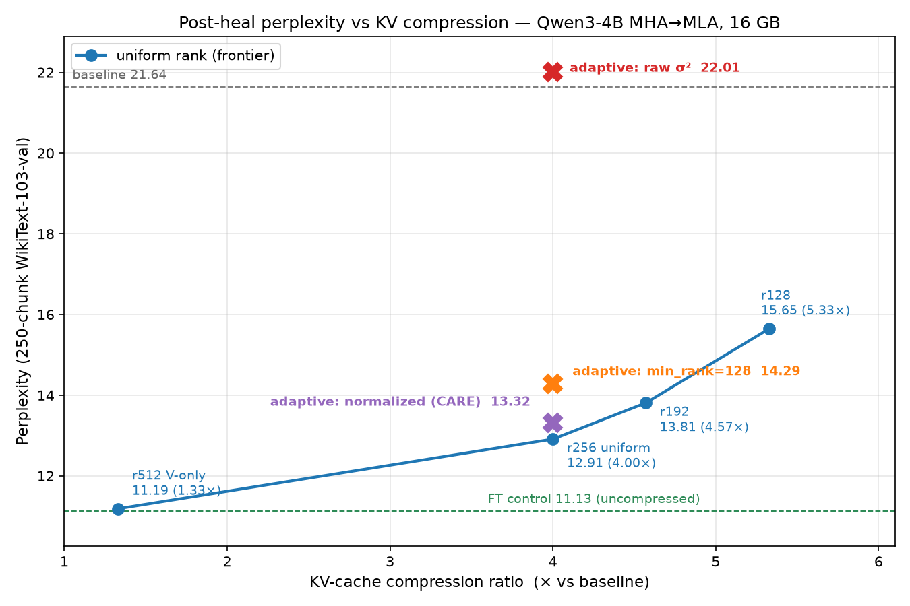

# Post-hoc MHA→MLA Conversion on a Single GPU

[](https://github.com/aaholmes/llms/actions/workflows/tests.yml)

> **Status — v0.1.** Stage A (engine) and Stage A.5 (Triton kernels) are complete and tested. Stage B (post-hoc MHA→MLA conversion of Qwen3-4B) has the full pipeline shipped end-to-end, including a **LoRA + MLA-projection healing finetune**. The headline: a **4× KV-cache reduction for ~+16 % perplexity** after healing, measured against a same-budget finetuned control (so the figure isolates compression cost from domain adaptation). Without healing the same 4× point is unusable (+826 % PPL); healing closes essentially all of that gap. The full compression–quality frontier (1.33× at +0.5 % up to 5.33× at +41 %), a negative result on per-layer adaptive rank (uniform beats it — even done [CARE](https://arxiv.org/abs/2603.17946)'s way), and a behavioral-fidelity (KL-to-original) view are in the [results](#stage-b-perplexity-results). This pipeline lands in the same place as CARE (Mar 2026), which published the closest method; our distinct pieces are joint `[K;V]` latent factoring, an honest same-budget-control methodology, and the adaptive-rank characterization. Stage C (joint compression × spec-decode sweep at fixed VRAM): pending.

## At a glance

**What.** A from-scratch single-GPU inference engine for Qwen3 that doubles as a research harness for **post-hoc MHA→MLA conversion** — turn an existing trained model's attention into DeepSeek-style multi-head latent attention, then study how the resulting KV-cache compression interacts with speculative decoding at a fixed 16 GB VRAM budget.

**Why.** On a 16 GB consumer GPU, the KV cache is the binding constraint on context length and the dominant source of HBM traffic at decode time. MLA shrinks it ~4–8× in models that were trained with it; this project is asking what falls out if you bolt the same compression onto an existing MHA/GQA model after the fact, without retraining (or with only a small LoRA "healing" finetune).

**Hardware.** Single-GPU, 16 GB VRAM, Blackwell-class consumer card for runs; a separate dev machine for engine and conversion dev.

**Status (v0.1, May 2026).**
- **Engine** (Stage A) — bit-exact with HuggingFace on Qwen3-0.6B; **1.29× spec-decode speedup** at K=2–3 on Qwen3-4B target + Qwen3-0.6B draft (100 Dolly prompts).
- **Triton kernels** (Stage A.5) — fused `gate-up-silu` and `QKV` shipped; isolation microbench wins of 1.05× / 1.5–3×. The 1.5× **end-to-end** gate is missed at batch=1 BF16: the model is HBM-bound and launch overhead × spec-call count erodes the per-call gain.
- **MHA→MLA conversion** (Stage B) — full pipeline shipped: covariance calibration, activation-aware joint SVD over `[K_nope; V]`, partial-RoPE-aware swap, PPL sweep, **plus a LoRA + MLA-projection healing finetune** (`src/mla/heal.py`). The 4× operating point (`r256_drope32`) goes from **+826 % PPL Δ no-FT** to **+16 % vs a same-budget finetuned control** after a ~3 h heal on a 16 GB GPU (400 steps, ~13 M tokens, 92.6 M trainable params). The control — the *uncompressed* model finetuned on the same data/budget — is what makes the +16 % an honest compression cost rather than masked WikiText-103 domain adaptation. The V-only fallback stays clean at **+25–38 % PPL Δ** no-FT but caps at 1.45×.
- **Joint compression × spec-decode sweep** (Stage C) — pending.

**Code map.**
- `src/engine/` — manual Qwen3 forward pass, KV cache, spec-decode loop, `MLAttention` runtime
- `src/kernels/` — Triton fused gate-up-silu + QKV
- `src/mla/` — covariance collector (`calibrate.py`), activation-aware SVD (`svd.py`), conversion (`convert.py`), post-hoc swap (`swap.py`), **healing finetune (`heal.py`)**
- `src/bench/` — streaming PPL evaluator, demo, e2e bench
- `experiments/stage_b/` — calibration artifacts, conversion checkpoints, PPL sweep summaries

**One command per stage** (Qwen3-4B target):
```bash
uv run python -m mla.calibrate Qwen/Qwen3-4B --samples 1000 --chunk-tokens 256 --out experiments/stage_b/calib/wt103_1k.pt
uv run python -m mla.convert  Qwen/Qwen3-4B --rank 256 --d-rope 32 --calib wt103-1k
uv run python -m mla.heal     --mla-artifact experiments/stage_b/qwen_qwen3_4b_r256_drope32.pt --out experiments/stage_b/heal_r256_drope32
```

## What this is, why it matters

Generating text from a large language model token-by-token is bottlenecked by **KV-cache memory bandwidth**: at every new token, the GPU has to re-read a full set of cached "keys" and "values" — one pair per attention head, per past position — from main memory before it can compute the next token. On a 16 GB consumer GPU, that cache is the single biggest constraint on context length, and its memory traffic is what keeps decode rate well below peak compute.

**Multi-head Latent Attention (MLA)**, introduced in DeepSeek-V2 and adopted by every 2026 frontier model (DeepSeek V3/V4, Kimi K2.6, Nemotron 3), shrinks that cache by 4–8× by storing a single low-rank "latent" vector per token instead of one K and V vector per attention head, and reconstructing K/V on the fly. But the existing population of MHA/GQA models — Llama-3, Qwen3, Mistral — was trained without MLA and is stuck with the original full-size cache.

This project converts an existing model (**Qwen3-4B**) to MLA *after the fact*, **without retraining**. The recipe: collect per-layer activation statistics on a calibration corpus, run an SVD weighted by those statistics to choose a latent subspace that minimizes reconstruction error *on the actual activations the model sees*, and replace the original K/V projections with a small shared down-projection plus per-head up-projections. Validation runs on a from-scratch single-GPU inference engine that's bit-exact with HuggingFace's reference. The headline study is how the resulting KV compression interacts with **speculative decoding** at a fixed 16 GB VRAM budget — i.e. once you can fit either a longer context or a faster draft model in the freed memory, what's the throughput-vs-quality Pareto frontier?

**The wrinkle MLA solves with a "partial-RoPE split":** rotary position embedding (RoPE) is a position-dependent rotation that sits algebraically *between* the Q and K projections at attention time. That breaks the trick MLA otherwise uses to never reconstruct K at runtime — the rotation prevents you from fusing the K up-projection into Q at load time. The DeepSeek-V3 fix, which this project adopts as the conversion target, is to split every attention head's dimension into a no-RoPE subspace that gets compressed (and absorbed into Q) and a small RoPE-only subspace that stays full-rank but rotated.

## Status

Hard-gated stages; see `DESIGN.md` for the plan, hardware, and the future-extensions list.

- **Stage A — inference engine** — done. From-scratch sequential speculative-decoding engine for Qwen3-4B + Qwen3-0.6B. Manual forward pass (no `transformers.AutoModelForCausalLM` in the hot path), bit-exact with HuggingFace on Qwen3-0.6B; **1.29× speculative-decoding speedup** at K=2–3 on the formal e2e bench (see below).
- **Stage A.5 — Triton kernel** — done. Two fused Triton kernels (gate-up-silu, QKV projection) shipped with microbench wins of 1.05× and 1.50–2.98×; both clear isolation gates but do not improve the spec-decode hot path end-to-end. The 1.5× e2e ship gate was missed: at batch=1 in BF16 the target model is HBM-bandwidth-bound, and per-call kernel-launch overhead × ~14k spec calls per generation erodes the per-call gain.
- **Stage B — MLA conversion** — in progress.
  - ✅ **Activation-aware SVD primitive.** Pure-CPU fp64 routine that, given a weight matrix `W` and an activation covariance `C`, returns rank-`r` factors `(A, B)` minimizing `‖(W − AB) X‖_F` over the calibration distribution (not the unweighted Frobenius distance — this is the difference between the math working and not). 8 tests, including ridge backoff for ill-conditioned `C`.
  - ✅ **Per-layer covariance collector.** Forward-hook pipeline that streams a calibration corpus (1k × 256-token chunks of WikiText-103) through the engine and accumulates `C_ℓ = (1/N) Σ x_t x_tᵀ` per attention layer. **256k tokens accumulated through Qwen3-4B in 9.4 min on the 16 GB GPU**; all 36 layers symmetric and positive semidefinite, conditioning ~10⁴–10⁵ — well inside the default ridge regime. 9 tests.
  - ✅ **MLAttention runtime + compressed KV cache.** Drop-in replacement for the engine's standard attention module that consumes already-computed MLA factors, applies partial-RoPE per head, and serves attention against a cache storing `(c_kv, k_rope_pre)` per token. Single-norm-on-concatenated-K mode preserves *algebraic* equivalence to baseline GQA attention given full-rank factors — verified to ≤1e-5 in fp32 and ≤1e-10 in fp64. 12 tests covering a `d_rope` sweep, prefill+decode, and exact-low-rank construction.
  - ✅ **Conversion CLI + post-hoc swap.** `python -m mla.convert <hf-id> --rank ... --d-rope ... --calib ...` reads the calibration artifact and runs one *joint* SVD per layer over the stacked `[W_K_nope; W_V]` rows — joint factoring is what makes the down-projection `W_dkv` shared across K-nope and V (the whole point of MLA's compressed cache). Output is a self-contained `.pt` artifact swapped into a fresh `Qwen3Model` via `apply_mla(...)`. 14 synthetic tests + 2 real-Qwen3-0.6B end-to-end smokes. **Qwen3-4B converts in 55 s on CPU** at `rank=128, d_rope=32`, giving a structural KV-cache compression of **5.33×** before perplexity is even measured (target was ≥4×).
  - ✅ **Perplexity sweep on Qwen3-4B.** Streaming PPL over a held-out 250-chunk × 1024-token slice of WikiText-103 validation (disjoint from the train-split calibration). Two grids run: the headline `partial-rope` design and a `v-only` fallback (`d_rope = head_dim`, no nope subspace, K stays full-RoPE). With no finetuning the 4× point is unusable (+826 % PPL); a ~3 h healing finetune closes it to +16 % vs a same-budget control — see results below.
  - ✅ **Partial-RoPE pair-structure fix (v2).** The first sweep used a `d_rope`-sized RoPE table that re-paired and re-frequencied the rope subspace in a way the trained model has never seen. Replaced with sliced-original-`inv_freq` plus a head-dim permutation at conversion time so the rope subspace is the first `d_rope/2` *original* Qwen3 RoPE pairs, contiguous at the end of each head. The fix turned the 4×-compression operating point (`r256_drope32`) from PPL Δ +9,080 % into **+826 %** — an 11× drop. Lower-rank operating points still fail the 2 % Δ gate, but for SVD-rank reasons that the partial-RoPE fix can't address.
  - ✅ **Healing-finetune harness** (`src/mla/heal.py`). Hybrid trainable scope chosen to fit Qwen3-4B FT in 16 GB: **full FT on the new MLA projections** (`dkv`, `uk_nope`, `uv`, `kr` — SVD-init'd and need to *move*, not just receive a low-rank delta) **plus LoRA r=16 on Q/O and the MLP** (`gate`/`up`/`down`); embeddings, RMSNorms, and base projections stay frozen. AdamW with two LR groups (5e-5 / 1e-4), cosine schedule with 3 % warmup, gradient checkpointing per `DecoderBlock`. Validation hook calls the existing streaming PPL evaluator on a held-out WikiText-103 slice every N steps; best-val checkpoint persists only the ~90 M trainable params. 12 unit tests pass, including an explicit gradient-flow check through the MLA projections (regression guard against the KV-cache write detaching gradients). **Run on Qwen3-4B at the 4× point: pre-FT val PPL 201 → 13.5 in ~3 h, and +16 % vs a same-budget finetuned control on the headline slice** (see results below).
- **Stage C — joint sweep at fixed VRAM** — pending. How target-compression × draft-compression × spec-decode-K trade off at a fixed 16 GB VRAM budget. Three named regimes — both uncompressed, target only, both compressed at matched ratios — directly test whether coupling SVD distortion across target and draft preserves spec-decode acceptance relative to compressing the target alone.

## Stage B perplexity results

**Setup.** Eval slice is 250 chunks × 1024 tokens from WikiText-103 *validation* (disjoint from the 1k × 256-token train-split calibration). PPL is computed in BF16 on cuda with cache reset per chunk; the absolute baseline (≈21.6) is therefore higher than published sliding-window PPLs for Qwen3-class models, but the *ratio* between baseline and MLA is consistent across both grids and is what the comparison rests on.

**The bug we found, and the fix.** The first sweep showed catastrophic PPL on every partial-RoPE point (+5,400 % to +25,600 % Δ). Root cause: `MLAttention` was building its rope cos/sin table from a `d_rope`-sized inv_freq formula, and the conversion was slicing K rows contiguously (last `d_rope` per head) — together this re-paired and re-frequencied the rope subspace in a way the trained model has never seen. The fix selects the first `d_rope/2` *original* Qwen3 RoPE pairs as the rope subspace and applies a head-dim permutation at conversion time so the rope subspace lives at the contiguous end of each head with the original frequency-pair structure. After the fix (v2), the 4× compression operating point dropped from PPL Δ +9,080 % to **+826 %** — an 11× improvement on the only configuration that meets the project's headline compression target.

**Variant A — partial-RoPE, after the fix (v2).** K and V both compressed via shared latent; first `d_rope/2` original RoPE pairs kept faithful, lower-frequency pairs absorbed into the no-rope subspace.

| Config | rank | d_rope | KV B/tok | Compression | PPL | Δ % vs baseline | (Δ % under broken v1) |
|---|---:|---:|---:|---:|---:|---:|---:|
| baseline | — | — | 4096 | 1.00× | 21.64 | — | — |
| r128_drope64 | 128 | 64 | 1280 | 3.20× | 617.41 | +2,753 % | (+5,405 %) |
| **r256_drope32** | **256** | **32** | **1024** | **4.00×** | **200.33** | **+826 %** | (+9,080 %) |
| r192_drope32 | 192 | 32 | 896 | 4.57× | 521.50 | +2,310 % | (+16,473 %) |
| r128_drope32 | 128 | 32 | 768 | 5.33× | 2,253.30 | +10,311 % | (+13,624 %) |
| r96_drope32 | 96 | 32 | 704 | 5.82× | 8,205.83 | +37,815 % | (+16,994 %) |
| r64_drope32 | 64 | 32 | 640 | 6.40× | 155,706.42 | +719,346 % | (+25,648 %) |

The fix dramatically improves moderate-rank points (r256, r192, r128_drope64) and minimally helps r128_drope32. At very low ranks (96, 64) the fix actually *worsens* PPL: the SVD reconstruction error of the K-nope subspace is so large that the now-faithful downstream layers compound it harder than the broken pre-fix version did. That confirms what the moderate-rank improvements imply — past `rank ≈ 192`, the dominant failure mode is V-side / K-nope-side rank deficiency, not partial-RoPE structure.

**Variant B — V-only fallback** (`d_rope = head_dim`; no nope subspace, K stays full-rank with full RoPE preserved, only V gets factored through the latent). Numbers unchanged from v1 because at `d_rope = head_dim` the permutation is the identity and the inv_freq slice is the full inv_freq.

| Config | rank | d_rope | KV B/tok | Compression | PPL | Δ % vs baseline |
|---|---:|---:|---:|---:|---:|---:|
| baseline | — | — | 4096 | 1.00× | 21.64 | — |
| r1024_drope128 | 1024 | 128 | 4096 | 1.00× | 21.64 | −0.01 % (noise) |
| r768_drope128 | 768 | 128 | 3584 | 1.14× | 25.68 | +18.7 % |
| r512_drope128 | 512 | 128 | 3072 | 1.33× | 27.12 | +25.3 % |
| r384_drope128 | 384 | 128 | 2816 | 1.45× | 29.87 | +38.0 % |
| r256_drope128 | 256 | 128 | 2560 | 1.60× | 35.45 | +63.8 % |
| r128_drope128 | 128 | 128 | 2304 | 1.78× | 89.86 | +315.2 % |

**Healing finetune (the gate).** The no-FT gap at 4× is **rank-deficient SVD reconstruction**, not RoPE structure — the standard fix in the post-hoc MHA→MLA literature is a short healing finetune. `src/mla/heal.py` full-trains the new MLA projections (`dkv`, `uk_nope`, `uv`, `kr`) plus LoRA r=16 on Q/O and the MLP (92.6 M trainable params total), everything else frozen, gradient-checkpointed to fit Qwen3-4B in 16 GB. One ~3 h run (400 steps, ~13 M WikiText-103 tokens) on the 4× point converges cleanly.

Evaluated on the **same** 250-chunk validation slice as the sweep above:

| Model | 4× KV compression? | PPL | Δ% vs raw baseline | Δ% vs FT control |
|---|:--:|---:|---:|---:|
| raw baseline | no | 21.64 | — | — |
| no-FT `r256_drope32` | **yes** | 200.33 | +826 % | — |
| FT control (uncompressed, same budget) | no | 11.13 | −48.6 % | — |
| **healed `r256_drope32`** | **yes** | **12.91** | **−40.4 %** | **+16.0 %** |

The healed 4×-compressed model *beats* the raw baseline by 40 % — but that headline is **mostly WikiText-103 domain adaptation, not compression recovery**: a same-budget finetune of the *uncompressed* model (the control) reaches 11.13 on its own. The honest marginal cost of 4× KV compression, after healing, is **+16.0 % PPL** vs that control — modest and bounded, against a +826 % no-FT cliff. Running the control instead of comparing to the un-finetuned baseline is the difference between an honest number and a flattering one.

**The post-heal frontier.** Healing every operating point (each with the same recipe; the uncompressed FT control is amortized across all of them, since it doesn't depend on rank) traces the compression–quality curve:



| Config | Compression | PPL | Δ% vs baseline | Δ% vs FT control |
|---|---:|---:|---:|---:|
| `r512_drope128` (V-only) | 1.33× | 11.19 | −48.3 % | **+0.5 %** |
| **`r256_drope32`** (uniform) | 4.00× | 12.91 | −40.3 % | **+16.0 %** |
| `r192_drope32` | 4.57× | 13.81 | −36.2 % | +24.0 % |
| `r128_drope32` | 5.33× | 15.65 | −27.7 % | +40.6 % |

The curve is monotonic and the low end is nearly free: **1.33× compression costs +0.5 % PPL** vs the control — a deployment-safe point — rising to +16 % at 4× and +41 % at 5.33×.

**A negative result worth keeping: per-layer adaptive rank does not beat uniform — not even done the published way.** It's tempting to allocate the rank budget per layer by each layer's activation-weighted singular spectrum (keep the largest singular values — provably optimal for *reconstruction error* at a fixed budget). At 4×, every allocation scheme we tried is *worse* than uniform:

| 4× allocation | early-layer rank | PPL | Δ% vs FT control |
|---|---|---:|---:|
| **uniform** | 256 | **12.91** | **+16.0 %** |
| adaptive, normalized (CARE-style `σ²/tail`) | — | 13.32 | +19.7 % |
| adaptive, `min_rank=128` floor | 128 | 14.29 | +28.3 % |
| adaptive, raw `σ²` | 8 | 22.01 | +97.8 % |

Raw-`σ²` water-filling floors the early layers (their K/V spectra decay fast, so they *look* cheap to compress) and lands at +97.8 %. Protecting the early layers (`min_rank=128`) recovers most of it, and switching to **CARE's normalized score** `σ²_{r+1}/Σ_{m>r}σ²_m` (which makes layers of different spectral scale comparable) recovers most of the rest — confirming the failure mode is **early-layer starvation**. But even CARE's score lands at +19.7 %, still above uniform. The lesson: **per-layer reconstruction error is the wrong objective** — it can't see that an early layer's error propagates and amplifies through every downstream layer. This matches [CARE](https://arxiv.org/abs/2603.17946)'s own table, where adjusted-rank has *higher* PPL than uniform (it trades PPL for a small accuracy gain). A correct adaptive scheme needs end-to-end sensitivity (gradient/Hessian/ablation), not local spectra.

**Behavioral fidelity (KL to the original), not just PPL.** PPL asks "predict the data well"; the project's real objective is "behave like the *original* model." Measured directly — forward `KL(p_original ‖ p_healed)` and top-1 agreement, per token, on a 64-chunk subset:

| Config | Compression | KL to orig (nats) ↓ | Top-1 agree ↑ |
|---|---:|---:|---:|
| FT control (uncompressed) | 1.00× | 0.522 | 74.5 % |
| `r512_drope128` (V-only) | 1.33× | 0.557 | 73.2 % |
| **`r256_drope32`** (uniform) | 4.00× | **0.639** | **70.0 %** |
| adaptive normalized (CARE) | 4.00× | 0.665 | 69.1 % |
| adaptive `min_rank=128` | 4.00× | 0.723 | 67.6 % |
| adaptive raw `σ²` | 4.00× | 1.116 | 58.5 % |
| `r192_drope32` | 4.57× | 0.692 | 68.6 % |
| `r128_drope32` | 5.33× | 0.799 | 65.7 % |

Two things fall out. First, the KL ranking **exactly matches the PPL ranking** — uniform beats every adaptive scheme including CARE's — so the negative result is robust to the metric, not a PPL artifact. Second, the **uncompressed FT control already sits at KL 0.52 / 74.5 % agreement**: CE-healing on WikiText moves even the un-compressed model substantially away from the original, so on these CE-trained checkpoints KL-to-original is *dominated by adaptation drift*, with compression adding only a little on top (uniform 0.64 vs control 0.52). That is the direct motivation for the **next chapter**: a *distill-to-original* heal (train on KL to the frozen original, not cross-entropy on data) would drive this KL toward 0 and measure compression fidelity with no adaptation confound — see `DESIGN.md`.

Raw artifacts: `experiments/stage_b/eval_summary_frontier.{md,json}` + `frontier_plot.png` (the PPL frontier), `eval_summary_frontier_kl.{md,json}` (KL/agreement), per-point `heal_*/` and `control_ft/` training logs, and the eval drivers `eval_frontier.py` / `eval_frontier_kl.py` / `plot_frontier.py`. Earlier no-FT sweeps: `eval_summary_partial_rope_v2.md`, `eval_summary_v_only.md`. Per-config converted checkpoints under `experiments/stage_b/r*.pt` (gitignored).

## Engine speedups (Stage A end-to-end)

100 Dolly-15k prompts × 200 generated tokens, Qwen3-4B target in BF16 on a 16 GB Blackwell-class consumer GPU. Greedy baseline: **38.9 tok/s** (matches HuggingFace's `AutoModelForCausalLM` greedy at `use_cache=True` to one decimal place).

| draft | K=1 | K=2 | K=3 | K=4 | K=5 | K=7 |
|---|---:|---:|---:|---:|---:|---:|
| Qwen3-0.6B | 46.6 — 1.21× (acc 78.9%) | 49.7 — 1.29× (69.8%) | **50.3 — 1.29×** (64.5%) | 48.7 — 1.25× (58.3%) | 47.5 — 1.22× (53.2%) | 41.4 — 1.06× (42.7%) |
| Qwen3-1.7B | 43.7 — 1.13× (acc 82.6%) | 46.2 — 1.20× (75.8%) | **46.3 — 1.19×** (70.3%) | 44.7 — 1.15× (63.7%) | 42.1 — 1.08× (57.5%) | 39.0 — 1.00× (50.5%) |

**Optimal K = 2–3 for both drafts** (K=2 and K=3 are tied within run-to-run noise). The curve is sharply peaked: K=1 leaves performance on the table because per-round overhead dominates one drafted token, and K≥4 wastes draft work that the target rejects. Acceptance climbs monotonically as K drops (peaking at 78.9% / 82.6% at K=1), so the bottleneck above K=3 is acceptance, not draft cost; below K=2 it flips and the bottleneck is round overhead. The 0.6B draft beats the 1.7B at every K despite a lower acceptance rate — the 1.7B's larger draft-step compute cost outruns its acceptance-rate gain. K=7 is the breakeven point for the 1.7B draft; beyond that, drafting more tokens than the target will accept loses to a plain greedy run.

## Hardware

Target: a single 16 GB Blackwell-class consumer GPU. Engine and conversion development on a dev machine; Triton, profiling, calibration runs, and the sweeps on a CUDA desktop.

## License

Apache License 2.0 — see [`LICENSE`](./LICENSE) for the full text.
