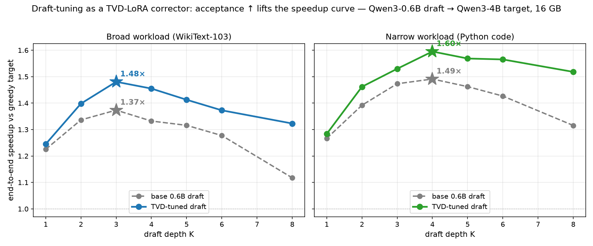

# Lossy Attention Blocks + a Learned Corrector

[](https://github.com/aaholmes/llms/actions/workflows/tests.yml)

**Make an already-trained large language model cheaper to run — no pretraining — by swapping in a lossy attention block and training a small adapter to claw back the quality it costs, both measured against a matched control.**

## The idea

Decoding one token at a time is bottlenecked by attention: the model re-reads a cached key and value for every head and every past position, and it re-runs a big target network for every token it emits. That memory traffic — not compute — sets the ceiling on context length and speed, and the ceiling bites soonest on a fixed GPU-memory budget (here, 16 GB).

There are several ways to make attention cheaper, and they sit on different axes:

- **Shrink what you store per token** — replace full-size keys/values with a small latent (Multi-head Latent Attention, MLA), cutting the key/value (KV) cache 4–8×.
- **Shrink the model that proposes tokens** — let a small draft model guess several tokens and have the target verify them in one pass (speculative decoding).

Each is *lossy*: it changes the model's output distribution and costs quality. This project treats them as instances of one pattern and applies the same corrector to both:

> **A cheap lossy attention block, plus a small low-rank (LoRA) adapter trained to minimize total-variation distance to the original — `TVD = ½‖p − q‖₁`, equivalently `1 − Σ min(p, q)` — pulling the degraded model back toward the original's next-token distribution.**

The metric is the point. TVD reads two ways depending on how the cheap model is deployed. When it *replaces* the original (standalone MLA), `1 − TVD` is a fidelity distance — the sharpest bound on how often the two models' behavior can diverge on any downstream measure. When it *proposes for* the original (speculative decoding — a small draft proposing for the MLA-compressed model as target), that same `1 − TVD` is literally the token accept-rate. Either way it is the quantity that cashes out — not a smooth surrogate like Kullback–Leibler (KL) divergence or cross-entropy. The adapter is tiny and **mergeable**, so once tuned for a workload it adds zero inference overhead.

Everything runs on a **from-scratch Qwen3 inference engine that is bit-exact with HuggingFace** — no `AutoModelForCausalLM` in the hot path, so the attention block can be swapped out and profiled directly.

---

## Instance 1 — MLA: shrink what you store, heal what you lose

**Convert Qwen3-4B to MLA after the fact, without retraining**, then quantify the KV-compression cost relative to a matched control.

1. **Calibrate.** Stream a corpus through the original model and record each attention layer's activation statistics.
2. **Compress.** Factor each layer's key and value (K/V) projections with a singular value decomposition (SVD) *weighted by those statistics*, so the low-rank latent minimizes error on the activations the model actually sees — one shared down-projection over `[K; V]` plus small per-head up-projections.
3. **Handle rotary embeddings.** Rotary position embeddings (RoPE) sit algebraically between the query and key projections and block MLA's fusion trick. Following DeepSeek-V3, each head splits into a compressed no-rotation subspace and a small full-rank rotated subspace ("partial RoPE").
4. **Heal.** A short finetune (~3 h on one 16 GB GPU) trains only the new latent projections plus small LoRA adapters and recovers most of the lost quality.

### The compression–quality frontier

Perplexity (PPL) on held-out WikiText-103 (Qwen3-4B, bfloat16; baseline PPL 21.6). Without finetuning, 4× compression is unusable (+826% PPL). After healing — measured against an *uncompressed model finetuned on the same data and the same budget*, so the figure is compression cost, not domain adaptation:

| KV compression | PPL cost vs matched control |
|---|---|
| 1.33× | **+0.5%** (deployment-safe) |
| 4.0× | **+16%** |
| 5.33× | +41% |


The matched control is the crux. A same-budget finetune of the *uncompressed* model reaches roughly the same absolute PPL on its own (mostly WikiText adaptation), so comparing against the raw baseline would flatter the result by ~40 points. The +16% is the true marginal cost of 4× compression.

### The corrector beats its surrogate

The real objective isn't "predict WikiText" — it's "behave like the original model." Fidelity here is `1 − TVD` to the frozen original: the fraction of probability mass the two models agree on, token by token. Healing on **KL-divergence** to the original drives the 4× model to KL 0.40 / 76% top-1 agreement — closer to the original than even a finetuned *uncompressed* model gets.

But KL is a surrogate for that fidelity, not the thing itself. Healing to minimize **TVD directly** beats the KL-trained model on every fidelity measure at once: **80% agreement (`1 − TVD`) at 4× vs 74%**, and lower KL and higher top-1 too. Optimizing the distance you care about wins over the smooth surrogate. (In a speculative-decode deployment this same 80% is the token accept-rate — see Instance 2.)

A **two-sided Fisher-weighted SVD initialization** — adding the output-gradient term the nearest published method omits — improves the starting point before any healing and holds a small consistent edge after.


### A negative result worth keeping

Allocating the rank budget per layer by each layer's activation spectrum — the "obvious" optimization — is *worse* than uniform allocation at every setting tried, because per-layer reconstruction error can't see that an early layer's error propagates and amplifies through every later layer. This corroborates the closest published method (CARE), whose adaptive allocation also underperforms uniform on perplexity.

---

## Instance 2 — Speculative decoding: shrink what proposes, tune what it says

The corrector is unchanged; only the lossy block differs. Here the "lossy" model is a **small draft** (Qwen3-0.6B) proposing tokens for the 4B target. A draft LoRA is TVD-tuned to a workload so the draft's proposals match what the target would say — raising acceptance, and with it end-to-end throughput. The adapter is merged before timing, so base and tuned drafts run at identical speed and only the weights differ.



Higher acceptance lifts the whole speedup-vs-depth curve and pushes the optimal draft depth K rightward:

| Workload | best-K speedup, base draft | best-K speedup, TVD-tuned | acceptance gain |
|---|---:|---:|---:|
| Broad (WikiText-103) | 1.37× (K=3) | **1.48× (K=3)** | 70% → 78% |
| Narrow (Python code) | 1.49× (K=4) | **1.60× (K=4)** | 73% → 81% |

The gain is **workload-dependent**, as the pattern predicts: a narrow workload starts from higher acceptance, so tuning buys more and the optimal K moves further out. The ceiling is set by draft cost, not acceptance. Profiling puts each draft forward at ~30% of a target forward — fixed per-round overhead inflates it above the 0.15 parameter ratio — which caps the optimal draft depth near 3–4. Past that, the lever is making the draft cheaper *relative to* the target (a smaller or quantized draft, or a larger target), not squeezing out more acceptance.

This is why the two instances belong in one repo: MLA lowers the *storage* cost of an operating point and speculative decoding lowers the *proposal* cost, but both degrade the output distribution, and the same recipe — **a TVD-trained LoRA** — repairs both.

---

## What's built, what's next

**Built and tested** (120 tests; a CPU-only subset runs in continuous integration):

- **Inference engine** — manual Qwen3 forward pass, contiguous and compressed KV caches, sequential speculative decoding; bit-exact with HuggingFace. Greedy matches HuggingFace tok/s to one decimal — the manual path pays no correctness-for-speed tax.
- **Two fused Triton kernels** — they win in isolation but do *not* beat NVIDIA's cuBLAS library end-to-end at batch=1: the decode path is memory-bandwidth-bound and per-launch overhead erodes the gain. Post-mortem in [`DESIGN.md`](./DESIGN.md).
- **MLA conversion** — calibration, activation-aware joint SVD, partial-RoPE swap, perplexity/KL/TVD evaluation, and the healing finetune (`src/mla/`).
- **Draft-tuning** — TVD-tuning a draft LoRA to a workload and target, with a merge-and-time end-to-end speedup bench.

**Planned:**

- **Joint sweep at fixed 16 GB** — how KV compression, draft choice, and draft depth trade off together, using the MLA-compressed model as the draft (freed KV budget cashes out as a fitter draft or longer context). The headline study the whole pipeline was built to run.

## Run it

```bash
uv sync --extra gpu
# MLA: calibrate → convert → heal (Qwen3-4B)
uv run python -m mla.calibrate Qwen/Qwen3-4B --samples 1000 --chunk-tokens 256 --out experiments/stage_b/calib/wt103_1k.pt
uv run python -m mla.convert  Qwen/Qwen3-4B --rank 256 --d-rope 32 --calib wt103-1k
uv run python -m mla.heal     --mla-artifact experiments/stage_b/qwen_qwen3_4b_r256_drope32.pt --out experiments/stage_b/heal_r256_drope32
uv run pytest
```

See [`DESIGN.md`](./DESIGN.md) for the full technical plan, prior work, and the objective/initialization/healing derivation.

## License

Apache License 2.0 — see [`LICENSE`](./LICENSE).
