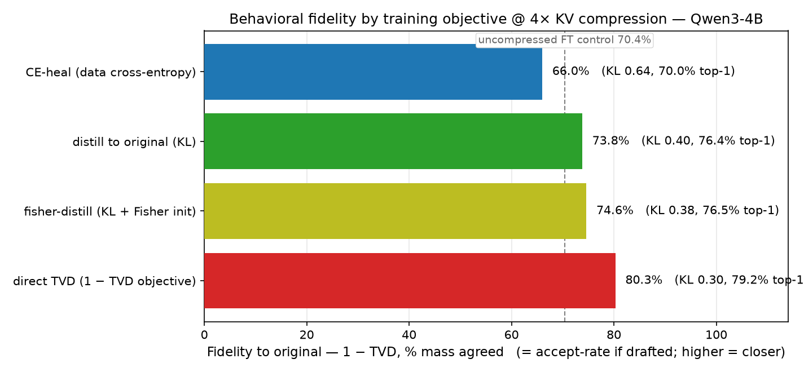

# Post-hoc MHA→MLA Conversion on a Single GPU

[](https://github.com/aaholmes/llms/actions/workflows/tests.yml)

**Retrofit a compressed-KV-cache attention architecture onto an already-trained model — no pretraining — and measure what it costs against a matched control.**

## The problem

Generating text from an LLM one token at a time is bottlenecked by **KV-cache memory bandwidth**: at every step the GPU re-reads a cached key and value vector for every attention head and every past position. On a 16 GB consumer GPU, that cache is the main limit on context length and the dominant source of decode-time memory traffic.

**Multi-head Latent Attention (MLA)** — introduced in DeepSeek-V2 and now standard in frontier models — shrinks that cache 4–8× by storing one small latent vector per token and reconstructing the keys and values on the fly. But the models most people actually run (Llama-3, Qwen3, Mistral) were trained *without* MLA and are stuck with a full-size cache.

This project **converts an existing model (Qwen3-4B) to MLA after the fact, without retraining it**, and quantifies the perplexity cost of the resulting KV compression — measured against a matched control so the number reflects compression, not confounds.

## How it works

1. **Calibrate.** Stream a calibration corpus through the original model and record each attention layer's activation statistics.
2. **Compress.** For each layer, factor the K/V projections with an SVD *weighted by those statistics*, so the low-rank latent minimizes error on the activations the model actually sees — one shared down-projection over `[K; V]` plus small per-head up-projections.
3. **Handle RoPE.** Rotary position embeddings sit algebraically between the Q and K projections and block MLA's usual fusion trick. Following DeepSeek-V3, each head is split into a compressed no-rotation subspace and a small full-rank rotated subspace ("partial RoPE").
4. **Heal (optional).** A short finetune (~3 h on one 16 GB GPU) that trains only the new latent projections plus small LoRA adapters recovers most of the quality lost to compression.

Everything is validated on a **from-scratch Qwen3 inference engine that is bit-exact with HuggingFace** — no `AutoModelForCausalLM` in the hot path, so attention can be swapped out and profiled directly.

## Key results

Perplexity on held-out WikiText-103 (Qwen3-4B, BF16; baseline PPL 21.6).

Without any finetuning, 4× KV compression is unusable (+826% PPL). After healing — and measured against an *uncompressed model finetuned on the same data and the same budget*, so the figure is compression cost rather than domain adaptation:

| KV compression | PPL cost vs matched control |
|---|---|
| 1.33× | **+0.5%** (deployment-safe) |
| 4.0× | **+16%** |
| 5.33× | +41% |


The matched control is the crux. A same-budget finetune of the *uncompressed* model reaches roughly the same absolute PPL on its own (it's mostly WikiText adaptation), so comparing against the raw baseline would flatter the result by ~40 points. The +16% is the true marginal cost of 4× compression.

**Behavioral fidelity.** The real objective isn't "predict WikiText" — it's "behave like the original model." Training the heal on KL-divergence to the frozen original (rather than cross-entropy on data) drives the 4× model to **KL 0.40 / 76% top-1 agreement** — closer to the original than even a finetuned *uncompressed* model gets.

But KL is a *surrogate*. What a speculative-decode verifier actually cares about is **acceptance** — the fraction of the compressed model's tokens the original would accept, `Σ min(p, q) = 1 − TVD`. Training the heal to maximize acceptance *directly* beats the KL-trained model on its own terms: **80% acceptance at 4× vs 74%**, and better on KL and top-1 agreement too. Optimizing the deployment metric wins over the smooth surrogate.

A **two-sided Fisher-weighted SVD initialization** — adding the output-gradient term the nearest published method omits — improves the starting point before any healing and holds a small consistent edge after.



**A negative result worth keeping.** Allocating the rank budget per layer by each layer's activation spectrum — the "obvious" optimization — is *worse* than uniform allocation at every setting tried, because per-layer reconstruction error can't see that an early layer's error propagates and amplifies through every later layer. This corroborates the closest published method (CARE), whose adaptive allocation also underperforms uniform on perplexity.

**Engine.** Speculative decoding on the from-scratch engine gives **1.29× over greedy** at draft depth K=2–3 (Qwen3-4B target, Qwen3-0.6B draft, 100 prompts). Greedy itself matches HuggingFace tok/s to one decimal — the manual forward pass is not paying a correctness-for-speed tax.

## What's built, what's next

**Built and tested** (120 tests, CPU subset in CI):
- **Inference engine** — manual Qwen3 forward pass, contiguous and compressed KV caches, sequential speculative decoding; bit-exact with HuggingFace.
- **Two fused Triton kernels** — they win in isolation but do *not* beat cuBLAS end-to-end at batch=1: the decode path is memory-bandwidth-bound and per-launch overhead erodes the gain. Post-mortem in [`DESIGN.md`](./DESIGN.md).
- **Conversion pipeline** — calibration, activation-aware joint SVD, partial-RoPE swap, perplexity/KL evaluation, and the healing finetune (`src/mla/`).

**In progress:**
- **Joint sweep** — how KV compression, draft-model choice, and speculative-decode depth trade off at a fixed 16 GB VRAM budget; the headline study the whole pipeline was built to run. First data point: training a small draft to *match* the target (rather than shrinking it) raises its single-token acceptance **59% → 68%**. Next: end-to-end throughput across the full grid.

## Run it

```bash
uv sync --extra gpu
# calibrate → convert → heal (Qwen3-4B)
uv run python -m mla.calibrate Qwen/Qwen3-4B --samples 1000 --chunk-tokens 256 --out experiments/stage_b/calib/wt103_1k.pt
uv run python -m mla.convert  Qwen/Qwen3-4B --rank 256 --d-rope 32 --calib wt103-1k
uv run python -m mla.heal     --mla-artifact experiments/stage_b/qwen_qwen3_4b_r256_drope32.pt --out experiments/stage_b/heal_r256_drope32
uv run pytest
```

See [`DESIGN.md`](./DESIGN.md) for the full technical plan, prior-art lineage, and the objective/initialization/healing derivation.

## License

Apache License 2.0 — see [`LICENSE`](./LICENSE).
